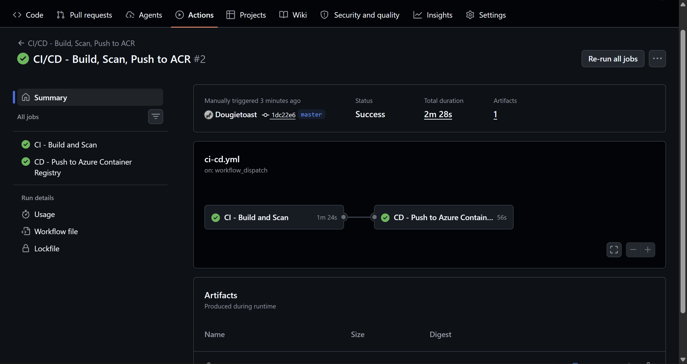
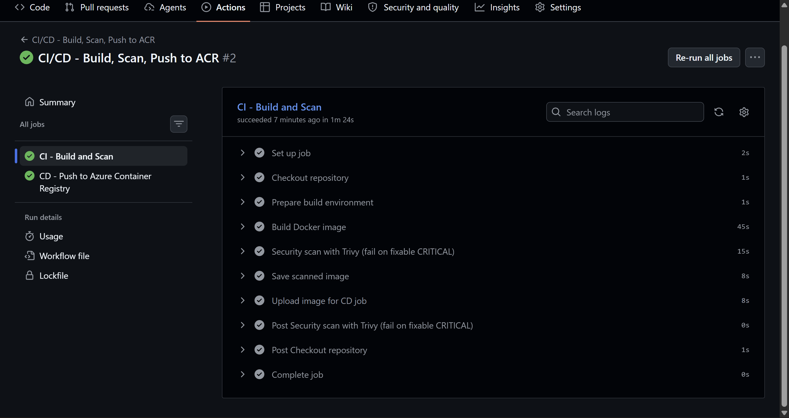
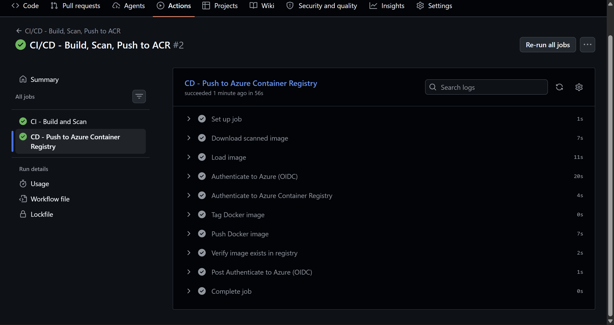
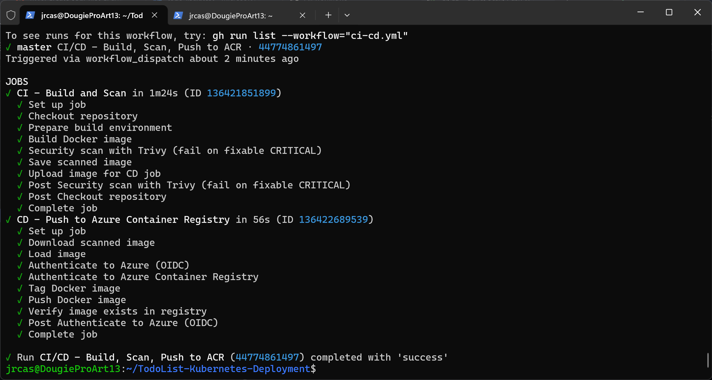
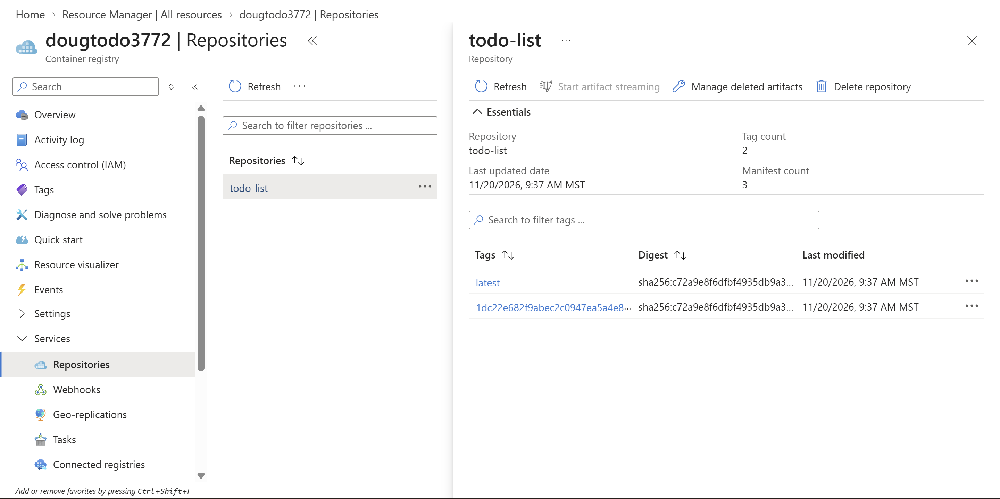
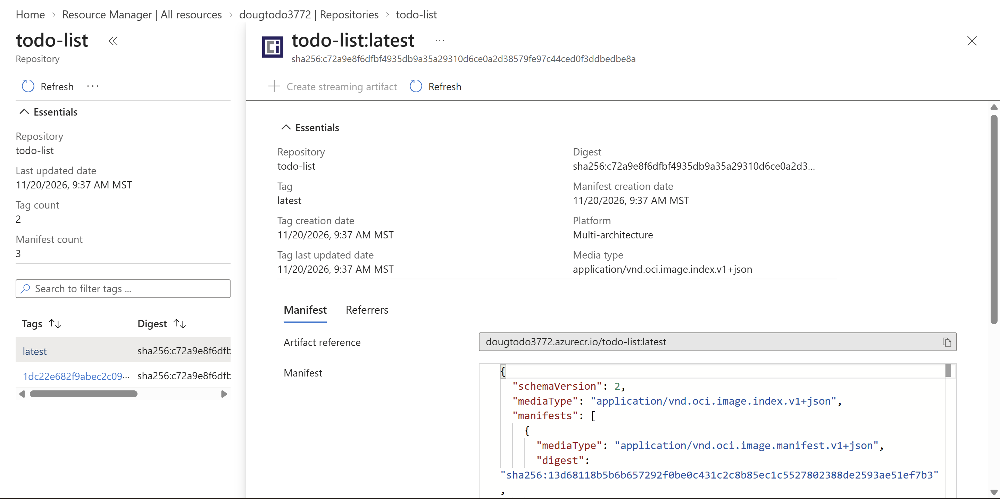

# M10: CI/CD Pipeline: Build, Scan, and Publish to Azure Container Registry

**Student:** Douglas · **Course:** IT 3200 (Fall 2026)

**Workflow file:** [`.github/workflows/ci-cd.yml`](../.github/workflows/ci-cd.yml)
**Successful run:** [Run #2 (44774861497)](https://github.com/Dougietoast/TodoList-Kubernetes-Deployment/actions/runs/44774861497)
**Registry:** Azure Container Registry `dougtodo3772.azurecr.io`, repository `todo-list`

## Architecture

```
Developer
    ↓  git push / manual run
GitHub Repository (master)
    ↓
CI job: "CI - Build and Scan"
    Checkout → Prepare environment → Docker build → Trivy scan → Save scanned image
    ↓  needs: ci  (CD only starts if CI succeeded)
CD job: "CD - Push to Azure Container Registry"
    Load scanned image → Azure login (OIDC) → ACR login → Tag → Push → Verify
    ↓
Azure Container Registry: dougtodo3772.azurecr.io/todo-list:latest and :<commit SHA>
```

### Design choices

- **One workflow, two jobs.** The `cd` job declares `needs: ci`, so nothing is published unless the build and security scan pass. Pull requests run CI only; pushes to `master` run CI and CD.
- **The scanned image is the pushed image.** The CI job saves the exact image Trivy scanned and passes it to the CD job as a workflow artifact. The CD job does not rebuild, so what lands in the registry is guaranteed to be what passed the scan.
- **Security gate:** Trivy fails the pipeline on any **CRITICAL** vulnerability that has a fix available. When I first audited the app's dependencies there were 6 critical vulnerabilities; I fixed them with `npm audit fix` before the pipeline could pass. The remaining HIGH findings are locked in by `react-scripts` 5 (no longer maintained) and would require replacing the build tool.
- **No passwords in GitHub.** GitHub Actions authenticates to Azure with **OIDC (workload identity federation)**: Azure trusts a short-lived token that GitHub issues for this repository's `master` branch. The repository secrets hold only IDs (client, tenant, subscription), and no Azure password or key exists that could leak. The identity has only `AcrPush` and `Reader`, scoped to this one registry.
- **Pinned actions.** Every third-party action is pinned to a full commit SHA instead of a version tag, so a re-pointed tag cannot swap in different code. This matters because the `trivy-action` tags were hijacked in a supply-chain attack in March 2026.
- **Tags:** each image is pushed as `latest` and as the Git commit SHA, so every image can be traced back to the exact code that built it.

## Screenshot 1: GitHub Actions

**Run summary:** both jobs succeeded, and CD ran after CI.



**CI job:** checkout, Docker build, and Trivy security scan.



**CD job:** Azure authentication (OIDC), registry login, tag, push, and verification.



**Full run from the terminal** (`gh run watch`): every step of both jobs, ending in `success`.



## Screenshot 2: Container Registry

The `todo-list` repository in `dougtodo3772`, with the `latest` and commit-SHA tags.



## Screenshot 3: Image Details

`todo-list:latest`: repository, tag, digest, and full artifact reference `dougtodo3772.azurecr.io/todo-list:latest`.



## Reflection

**1. What is the difference between CI and CD?**
CI (Continuous Integration) checks that the code still builds and passes checks every time it changes. In my pipeline, that is checkout, the Docker build, and the Trivy scan. CD (Continuous Delivery) takes a build that passed and makes it available for release automatically. Here, that means logging in to Azure, tagging the image, and pushing it to the container registry. CI answers "is this build good?"; CD gets the good build to where it can be deployed.

**2. Why should the Docker image be built and scanned before it is pushed to the registry?**
The registry is where deployments pull from, so anything in it should already be trusted. Scanning first stops known vulnerabilities before they reach a system that could run them. In my pipeline, the CD job pushes the exact image the CI job scanned, instead of rebuilding it, so the registry only ever holds an image that passed the scan. This was not hypothetical: the first audit found 6 critical vulnerabilities, and the pipeline would not have published until they were fixed.

**3. What would happen if the CI build failed?**
The CD job depends on CI (`needs: ci`), so it would never start. Nothing would be pushed, the registry would keep the last good image, and GitHub would mark the run as failed so the problem gets fixed first. I saw this in practice: on my first run the Azure login failed, and no image was published until I fixed the federated credential and ran the pipeline again.

**4. Why is it useful to store Docker images in a container registry?**
It gives one central, versioned place for built images. Any server or Kubernetes cluster can pull the same image without rebuilding it, which keeps every environment consistent. Tags (`latest` plus the commit SHA) make each image traceable to the code that produced it and make rollback easy. Access is controlled through Azure roles instead of shared passwords.

**5. What additional step would be required to deploy this image into Kubernetes?**
The cluster needs permission to pull from the registry (for AKS, `az aks update --attach-acr`, or an image pull secret on other clusters). Then a Deployment manifest, or this repository's Helm chart, would point at `dougtodo3772.azurecr.io/todo-list:<tag>` and be applied with `kubectl apply` or `helm upgrade --install`. That deploy step could be added as a third job in the same pipeline.
